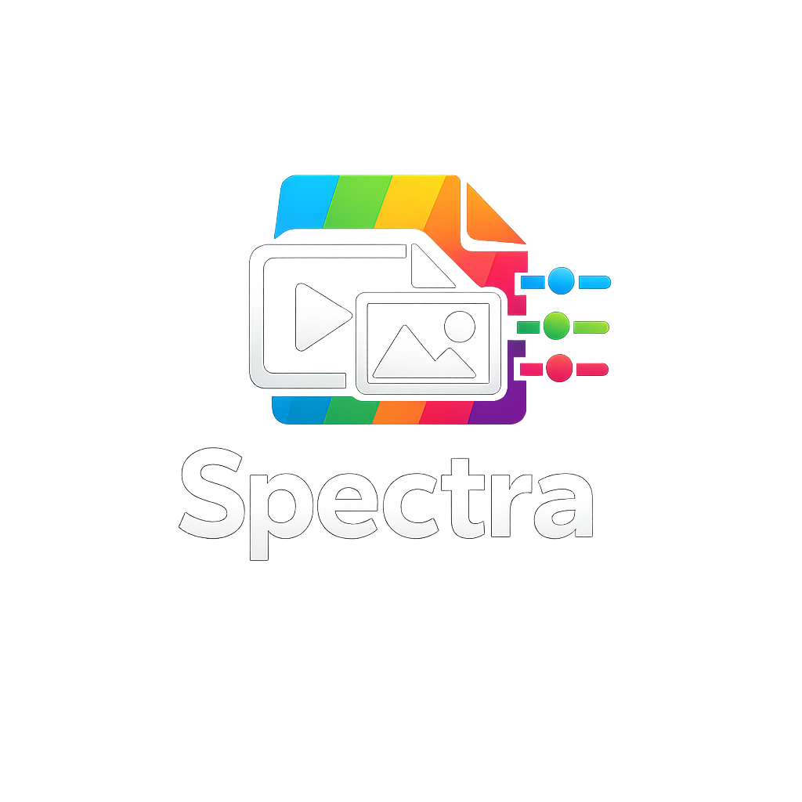
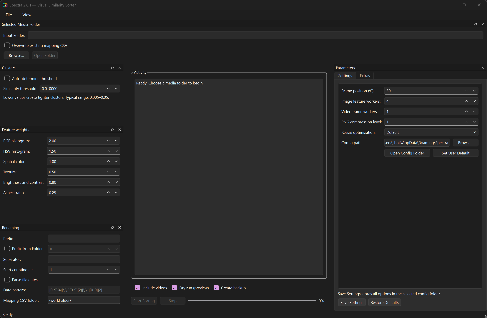

# Spectra

Sort and rename images and videos by visual similarity.

## Features

- Group media by color, composition, texture, brightness, and aspect ratio.
- Adjust similarity weights, grouping thresholds, and filename prefixes.
- Preview renaming with a dry run, back up originals, and export a CSV name mapping.
- Track sorting progress in the desktop app.

## Install

- Download `Spectra-*-windows-amd64-Setup.exe` from the [latest release](https://github.com/electblake/Spectra/releases/latest).
- Run the installer; setup downloads Python and installs dependencies.
- Launch Spectra from the Start Menu.
- See the [usage guide](docs/usage.md) for settings, output files, and updates.
